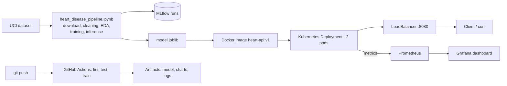

# Heart Disease Prediction – MLOps Pipeline

This project predicts the risk of heart disease from patient health data
(UCI Heart Disease dataset). The model is served as an API in Docker, deployed
on Kubernetes and monitored with Prometheus and Grafana. A GitHub Actions
pipeline lints, tests and trains the model on every push.

**Code repository:** https://github.com/Shreya2025ae05052/MLOps_Assignment1

---

## Architecture



## Project structure

```
heart-disease-mlops/
├── heart_disease_pipeline.ipynb   download, cleaning, EDA, training, MLflow, inference
├── api/
│   ├── main.py                    FastAPI app: /predict, /health, /metrics
│   └── requirements.txt           libraries for the Docker image
├── test/                          unit tests (pytest)
├── k8s/                           Kubernetes files (API, Prometheus, Grafana)
├── .github/workflows/ci.yml       GitHub Actions pipeline
├── data/raw/                      downloaded dataset
├── data/cleaned/                  cleaned dataset
├── models/                        saved model + metrics.json
├── outputs/                       EDA and training charts
├── screenshots/                   screenshots for the report
├── report/                        final report (Word)
├── Dockerfile
├── requirements.txt
└── sample_input.json              example patient for the API
```

---

## 1. Data acquisition and EDA

- **Dataset:** Cleveland subset of the UCI Heart Disease dataset (303 patients,
  13 features + target). The notebook downloads it automatically. This subset
  is used because it is the most complete one.
- **Missing values:** stored as `?`, only in `ca` (4) and `thal` (2). These 6
  rows were removed, because it is a very small part of the data.
  **297 rows** remain.
- **Target:** `num` (0–4) was changed to a binary `target`:
  0 = no disease, 1 = disease.
- **Charts** (in `outputs/eda/`): histograms of the numeric features,
  correlation heatmap and class balance.

What the EDA showed:

- The classes are almost balanced: 160 without disease (54%), 137 with disease (46%).
- `thal`, `ca`, `exang`, `oldpeak` and `cp` are most related to heart disease.
  A lower maximum heart rate (`thalach`) also means a higher risk.
- `chol` and `oldpeak` have a few high values. They are real measurements, so
  they were kept.

## 2. Feature engineering and model development

- Numeric features (`age`, `trestbps`, `chol`, `thalach`, `oldpeak`, `ca`) are
  scaled with **StandardScaler**.
- Category features (`sex`, `cp`, `fbs`, `restecg`, `exang`, `slope`, `thal`)
  are **one-hot encoded**, because their numbers are labels, not amounts.
- Data split: 80% training, 20% test (stratified).
- Two models, each tuned with **GridSearchCV and 5-fold cross-validation**:

| Model | Settings tried | Best settings |
|---|---|---|
| Logistic Regression | `C` = 0.01, 0.1, 1, 10 | `C = 0.1` |
| Random Forest | `n_estimators` = 100, 200; `max_depth` = None, 5, 10; `min_samples_split` = 2, 5 | `n_estimators = 200`, `max_depth = 5`, `min_samples_split = 2` |

Results (CV = 5-fold cross-validation on the training data, Test = 20% test set):

| Metric | Logistic Regression | Random Forest |
|---|---|---|
| CV accuracy | 0.835 | 0.814 |
| CV precision | 0.858 | 0.834 |
| CV recall | 0.778 | 0.760 |
| CV ROC-AUC | 0.8955 | **0.8959** |
| Test accuracy | 0.867 | 0.867 |
| Test precision | 0.885 | 0.885 |
| Test recall | 0.821 | 0.821 |
| Test ROC-AUC | 0.952 | 0.944 |

**Selected model: Random Forest**, because it has the highest cross-validated
ROC-AUC. ROC-AUC shows how well the model separates sick and healthy patients.
The two models are very close, so both are good choices for this data.

## 3. Experiment tracking (MLflow)

Each model is one run in the MLflow experiment `heart-disease`. Every run saves:

- **Parameters:** model type and best settings
- **Metrics:** CV and test accuracy, precision, recall, ROC-AUC
- **Artifacts:** confusion matrix, ROC curve, grid search results (CSV) and the model

## 4. Model packaging and reproducibility

- The preprocessing and the model are saved together as one scikit-learn
  **Pipeline** in `models/model.joblib`. New data gets exactly the same
  scaling and encoding as the training data.
- The model is also saved in MLflow format in each run.
- All library versions are pinned in `requirements.txt`, and `random_state=42`
  is used everywhere, so every run gives the same results.

## 5. CI/CD and testing

**Unit tests** (`test/`, 14 tests with pytest):

- `test_data.py` – cleaning (missing values, duplicates, binary target) and preprocessing
- `test_model.py` – predictions, probabilities, metrics, saving/loading, inference
- `test_api.py` – `/health`, `/predict`, wrong input (422) and `/metrics`

**GitHub Actions** (`.github/workflows/ci.yml`) has three jobs that run in order:

1. **lint** – flake8 checks the code and the notebook
2. **test** – pytest runs all unit tests
3. **train** – runs the whole notebook (download, training, saving the model)

If a job fails, the next jobs do not run. Every run uploads its test results,
logs, model, charts and MLflow runs as **artifacts**.

## 6. Docker container

The API is built with **FastAPI**:

- `POST /predict` takes patient data as JSON and returns the prediction and the
  confidence (probability of the predicted class)
- `GET /health` checks if the API is running
- `GET /metrics` gives metrics for Prometheus

The Docker image (`Dockerfile`) uses Python 3.11 and contains the API and the
trained model.

## 7. Deployment (Kubernetes)

The image is deployed on **Kubernetes in Docker Desktop** (`k8s/api-deployment.yaml`):

- a Deployment with **2 pods**
- a **LoadBalancer** Service on port 8080
- a readiness check on `/health`, so requests only go to pods that are ready

## 8. Monitoring and logging

- **Logging:** the API logs every request (method, path, status, time) and
  every prediction. See them with `kubectl logs -l app=heart-api`.
- **Prometheus** (`k8s/prometheus.yaml`) collects the metrics from both pods
  every 15 seconds.
- **Grafana** (`k8s/grafana.yaml`) shows them on a dashboard.

---

## How to run

### Requirements

- Python 3.11 (3.12 also works)
- Git
- Docker Desktop with Kubernetes turned on
  (Settings → Kubernetes → Enable Kubernetes → **kubeadm**)

All commands are run from the project folder.

### 1. Install

```bash
python -m venv venv

# Windows
venv\Scripts\activate
# Mac / Linux
source venv/bin/activate

pip install -r requirements.txt
```

### 2. Run the ML pipeline

```bash
jupyter notebook heart_disease_pipeline.ipynb
```

Then **Kernel → Restart & Run All**. This downloads the data, cleans it, makes
the EDA charts, trains both models, logs them to MLflow, saves the best model
to `models/model.joblib` and makes a test prediction.

To run it without opening Jupyter:

```bash
jupyter nbconvert --to notebook --execute --inplace heart_disease_pipeline.ipynb
```

If the download does not work: get `processed.cleveland.data` from
https://archive.ics.uci.edu/dataset/45/heart+disease, add this header line
`age,sex,cp,trestbps,chol,fbs,restecg,thalach,exang,oldpeak,slope,ca,thal,num`
and save it as `data/raw/heart_raw.csv`.

### 3. MLflow

```bash
mlflow ui
```

Open http://localhost:5000.

### 4. Tests and lint

```bash
pytest -v
flake8 api test
nbqa flake8 heart_disease_pipeline.ipynb --extend-ignore=E302,E303,E305
```

### 5. Docker

Run step 2 first, because the image includes the trained model.

```bash
docker build -t heart-api:v1 .
docker run -p 8000:8000 heart-api:v1
```

In a second terminal (on Windows PowerShell use `curl.exe`):

```bash
curl -X POST http://localhost:8000/predict -H "Content-Type: application/json" --data-binary @sample_input.json
```

Response: `{"prediction": 0, "confidence": 0.6976}`

### 6. Kubernetes

```bash
kubectl apply -f k8s/api-deployment.yaml
kubectl get pods
kubectl get services
curl http://localhost:8080/health
curl -X POST http://localhost:8080/predict -H "Content-Type: application/json" --data-binary @sample_input.json
kubectl logs -l app=heart-api
```

### 7. Monitoring

```bash
kubectl apply -f k8s/prometheus.yaml
kubectl apply -f k8s/grafana.yaml
```

To create test traffic: in the notebook, section 10, set `RUN_REQUESTS = True`
and run that cell (it sends 50 requests to the API).

- Prometheus: http://localhost:9090 (Status → Targets shows both pods as UP)
- Grafana: http://localhost:3000, login `admin` / `admin`

Grafana dashboard panels (Prometheus is already added as the data source):

| Panel | Query |
|---|---|
| Total predictions | `sum(http_requests_total{handler="/predict"})` |
| Requests per second | `sum(rate(http_requests_total[1m])) by (handler)` |
| Average response time (s) | `sum(rate(http_request_duration_seconds_sum{handler="/predict"}[1m])) / sum(rate(http_request_duration_seconds_count{handler="/predict"}[1m]))` |
| Errors (4xx / 5xx) | `sum(http_requests_total{status=~"4xx\|5xx"})` |

To remove everything from Kubernetes: `kubectl delete -f k8s/`

### 8. CI/CD

The pipeline runs on every push. Results are in the **Actions** tab of the
repository; the artifacts are at the bottom of each run.

---

## API access

The API runs locally. URLs: Docker `http://localhost:8000`, Kubernetes `http://localhost:8080`.

| Endpoint | Method | Description |
|---|---|---|
| `/predict` | POST | Prediction (0 = no disease, 1 = disease) and confidence |
| `/health` | GET | Health check |
| `/metrics` | GET | Prometheus metrics |
| `/docs` | GET | Interactive API page |

`/predict` request (all 13 fields are required):

```json
{"age": 63, "sex": 1, "cp": 1, "trestbps": 145, "chol": 233, "fbs": 1,
 "restecg": 2, "thalach": 150, "exang": 0, "oldpeak": 2.3, "slope": 3,
 "ca": 0, "thal": 6}
```

## Screenshots and report

- Screenshots: [`screenshots/`](screenshots/README.md)
- Final report: `report/MLOps_Assignment1_Report.docx`
